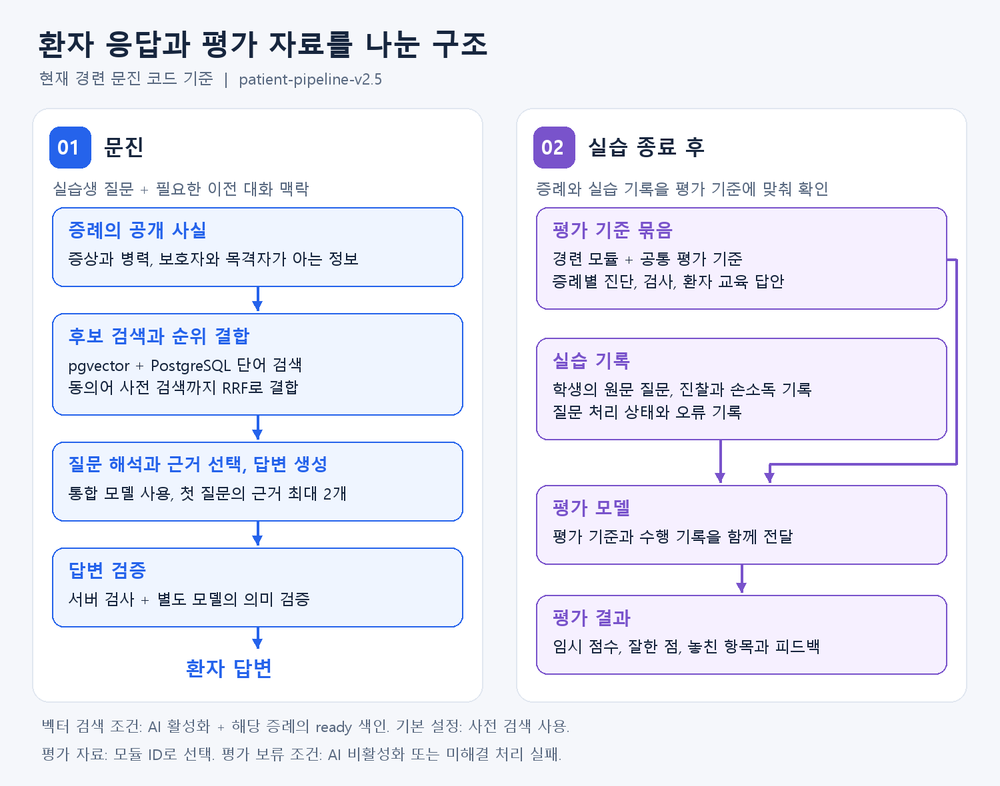
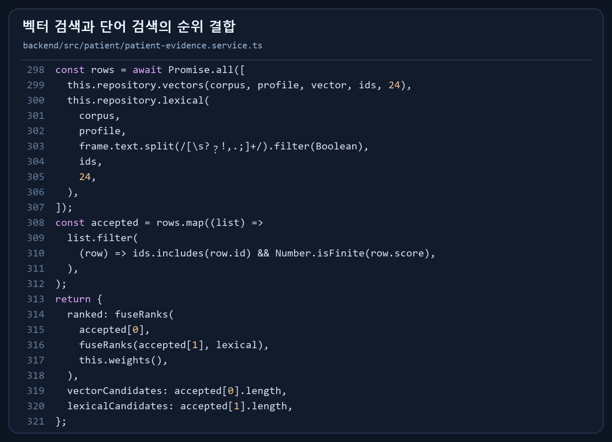
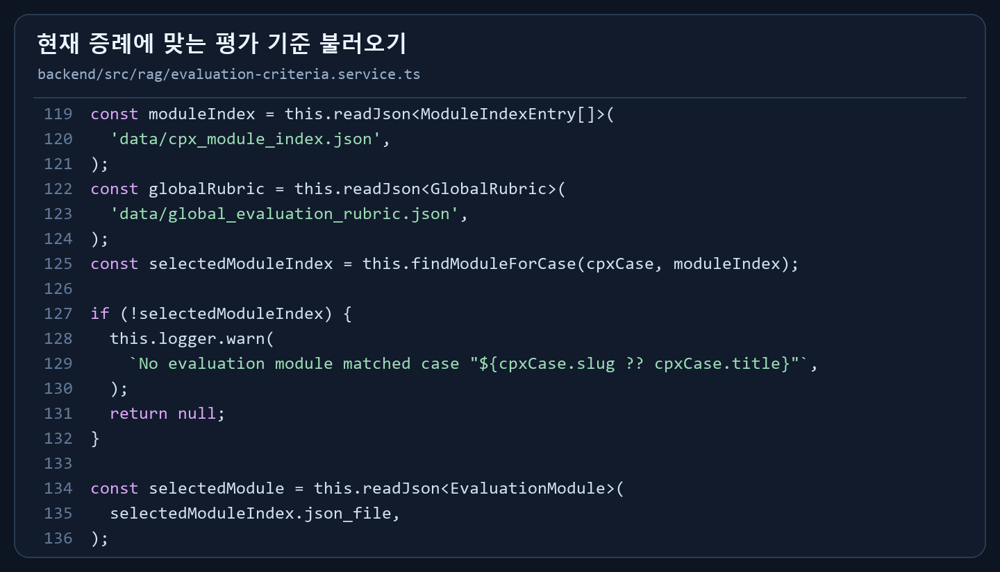
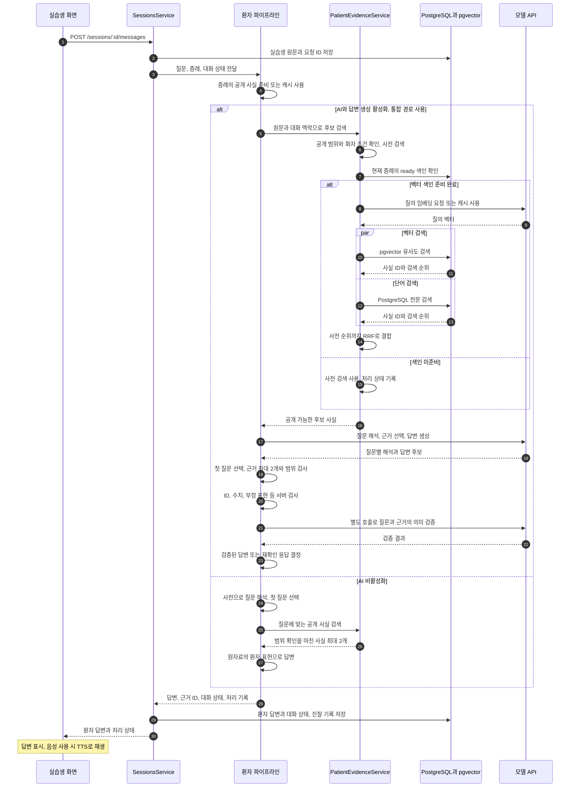
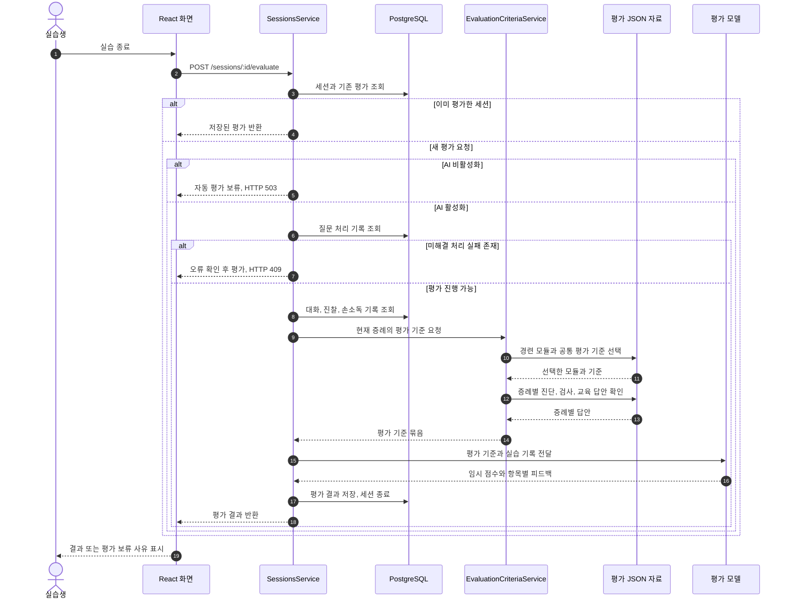
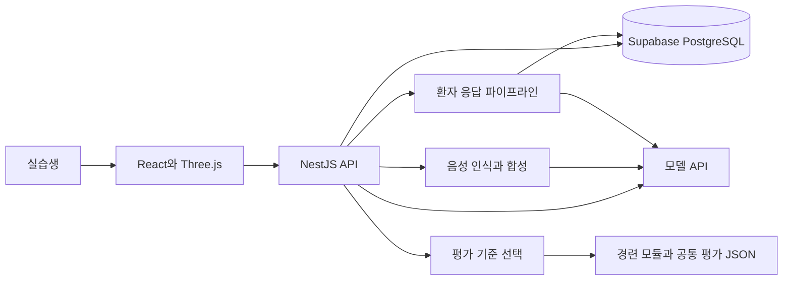

<p align="center">
  
</p>

<h1 align="center">Seizure CPX</h1>

<p align="center">
  3D 진료실에서 환자에게 질문하고, 진찰하고, 피드백을 받는 경련 CPX 연습 도구
</p>

<p align="center">
  <strong>🏆 2026 CODE:MEDI 해커톤 대상</strong><br />
  <sub>동아대학교 의과대학 주최</sub>
</p>

<p align="center">
  
  
  
  
  
</p>

<p align="center">
  <a href="https://code-medi-2026-1-team-frontend.vercel.app/">서비스 바로가기</a>
  &nbsp; | &nbsp;
  <a href="https://www.youtube.com/watch?v=vS0mFh-VEVU">시연 영상</a>
</p>

<br />

---

<br />

## 프로젝트 소개

Seizure CPX는 의대생이 혼자서도 경련 환자 문진을 연습할 수 있도록 만든 시뮬레이터입니다. 환자나 보호자에게 말로 질문하고, 3D 환자 모델을 진찰한 뒤, 빠뜨린 항목을 확인할 수 있습니다.

CPX는 환자에게 병력을 묻고 신체진찰과 환자 교육을 수행하는 실기 시험입니다. 이 프로젝트에서는 경련 증례를 바탕으로 문진부터 피드백까지 한 번에 연습할 수 있도록 구성했습니다.

| 항목 | 내용 |
| --- | --- |
| 팀 | Team 1, 아프지마 닥터 잠보 🐘 |
| 해커톤 개발 기간 | 2026.06.28 ~ 2026.06.29 |
| 실습 주제 | 경련 환자 문진, 신체진찰, 환자 교육 |
| 실습 시간 | 한 세션당 12분 |

<br />

---

<br />

## 목차

- [주요 기능](#주요-기능)
- [3D 진료실](#3d-진료실)
- [이중 RAG 구조](#이중-rag-구조)
- [동작 원리](#동작-원리)
- [RAG 시퀀스 다이어그램](#rag-시퀀스-다이어그램)
- [시스템 구성](#시스템-구성)
- [기술 스택](#기술-스택)
- [기술적 도전](#기술적-도전)
- [비용 기록과 호출 줄이기](#비용-기록과-호출-줄이기)
- [프로젝트 구조](#프로젝트-구조)
- [실행 방법](#실행-방법)
- [환경 변수](#환경-변수)
- [배포 설정](#배포-설정)
- [API](#api)
- [팀 소개](#-팀-소개-team)
- [3D 에셋 출처](#3d-에셋-출처)
- [면책 조항](#-면책-조항-disclaimer)

<br />

---

<br />

## 주요 기능

실습 흐름: **증례 선택 → 문진 → 신체진찰과 환자 교육 → 피드백**

| 기능 | 설명 |
| --- | --- |
| 음성 문진 | 음성 질문의 텍스트 변환과 전송, 환자 답변의 음성 재생 |
| 환자와 보호자 역할 | 소아 증례의 보호자 응답, 목격자에게 들은 정보와 환자가 직접 아는 정보 구분 |
| 3D 신체진찰 | 앉은 자세와 누운 자세 전환, 진찰 결과와 수행 기록 확인 |
| 손소독 기록 | 실습 시작, 진찰 전, 진찰 후의 손소독 시점 기록 |
| 문진 피드백 | 평가 기준에 따른 점수, 잘한 점, 놓친 항목 제공 |

- 음성 기능과 자동 평가: AI 사용 설정에 따라 활성화
- 기본 예시 설정: 텍스트 문진 사용, 새 자동 평가 보류

### 연령대별 환자 모델

- 경련 증례에 맞춘 소아, 청소년, 성인 모델
- 어린 환자의 병력을 보호자가 대신 설명하는 문진 상황

<table>
  <tr>
    <th width="50%">소아, 7개월</th>
    <th width="50%">소아, 9세</th>
  </tr>
  <tr>
    <td></td>
    <td></td>
  </tr>
  <tr>
    <th>청소년, 15세</th>
    <th>성인, 42세</th>
  </tr>
  <tr>
    <td></td>
    <td></td>
  </tr>
</table>

### 신체진찰

- 진료실과 침상 화면 이동, 환자 자세 전환
- Brudzinski 검사와 Kernig 검사 등 경련 관련 신체진찰

<table>
  <tr>
    <th width="50%">수막자극징후 검사</th>
    <th width="50%">침상 진찰 화면</th>
  </tr>
  <tr>
    <td></td>
    <td></td>
  </tr>
</table>

### 피드백 화면

- 문진에서 놓친 내용과 신체진찰 기록 확인
- 감별진단, 필요한 검사, 환자 교육 내용 평가

<p align="center">
  
</p>

- 현재 점수: 모델이 제안한 임시 평가
- 평가 보류 조건: 해결되지 않은 질문 해석 또는 답변 처리 실패

<br />

---

<br />

## 3D 진료실

- Three.js와 React Three Fiber 기반 진료실, 침상, 환자 모델 구성
- 채팅, 타이머, 환자 자세와 3D 장면 연동

| 구성 | 구현 내용 |
| --- | --- |
| 진료실 | 책상, 모니터, 침대가 있는 공간 |
| 환자 모델 | 증례와 연령에 맞는 환자 모델 |
| 자세 전환 | 문진할 때 앉은 자세, 진찰할 때 누운 자세 |
| 장면 전환 | 진료실과 침상 화면 이동 |
| 수행 기록 | 손소독 시점, 진찰 항목, 자세와 결과 저장 |

<p align="center">
  
</p>

무료 진료실 에셋 활용, 증례용 환자 모델과 일부 오브젝트 직접 제작

<br />

---

<br />

## 이중 RAG 구조

- 환자 응답 자료와 학생 평가 자료의 역할 분리
- 환자 답변에 정답 진단과 채점 기준이 섞이는 상황 방지

그림과 다이어그램 기준: 현재 저장소의 경련 문진 경로 `patient-pipeline-v2.5`

<p align="center">
  
</p>

| 구분 | 환자 응답 자료 | 평가 자료 |
| --- | --- | --- |
| 사용하는 내용 | 증상, 병력, 보호자와 목격자가 아는 정보 | 공통 평가 기준, 경련 문진 항목, 증례별 진단과 검사, 환자 교육 기준 |
| 자료 처리 | 질문에 답할 수 있는 개별 사실로 정리 | 현재 증례의 평가 모듈과 기준 선택 |
| 불러오는 방식 | 조건에 따라 벡터 검색과 단어 검색 병행 | 모듈 ID로 JSON 자료 선택 |
| 사용하는 시점 | 문진 중 질문 입력 시 | 실습 종료 후 평가 시 |

### 환자 응답 자료 검색

- 경련 증례 8개의 원자료를 개별 사실로 정리
- 발열 여부와 근육통 지속시간처럼 질문에 답할 수 있는 단위로 분리
- 사실별 대상, 발생 시점, 환자와 보호자, 목격자 등 정보 출처 기록
- 신체진찰 결과, 정답 진단, 채점 기준의 환자 답변용 사실 제외

**AI와 답변 생성 활성화 시 처리 순서**

1. 질문과 필요한 이전 대화 맥락으로 검색 후보 구성
2. 현재 증례에서 환자나 보호자에게 공개 가능한 사실 검색
3. 벡터 색인 준비 시 pgvector, PostgreSQL 단어 검색, 동의어 사전 검색 병행
4. RRF로 검색 순위 결합, 여러 검색에서 높은 순위에 나온 사실 우선
5. 통합 모델의 질문 해석, 근거 선택, 답변 생성
6. 첫 질문 하나에 대한 응답, 선택 근거 최대 2개
7. 서버 검사와 별도 모델 검증으로 질문, 근거, 답변의 일치 여부 확인

| 처리 조건 | 동작 |
| --- | --- |
| 검색 결과 확인 | 현재 증례와 자료 버전의 ID 재확인, 원자료의 값 사용 |
| 근거 부족 또는 모호한 질문 | 모른다는 응답 또는 재질문 |
| `PATIENT_COMBINED_ENABLED=false` | 질문 해석, 검색, 답변 생성의 분리 처리 |
| 분리 경로에서 `PATIENT_RERANK_ENABLED=true` | 모델을 통한 후보 재정렬 |

### 평가 자료 선택

- `EvaluationCriteriaService`에서 경련 모듈 `cpx-34-seizure`, 공통 평가 기준, 증례별 답안 구성
- 평가 기준에 학생 원문 질문, 진찰 기록, 손소독 기록을 추가해 평가 모델에 전달
- 벡터 유사도 검색 대신 증례에 연결된 모듈 ID로 평가 JSON 선택
- 이중 RAG의 의미: 환자 응답 자료와 평가 자료의 분리 관리

<details>
<summary>실제 구현 코드 보기</summary>

**검색 결과 순위 결합**



[PatientEvidenceService 코드](backend/src/patient/patient-evidence.service.ts)

**증례별 평가 기준 선택**



[EvaluationCriteriaService 코드](backend/src/rag/evaluation-criteria.service.ts)

</details>

<br />

---

<br />

## 동작 원리

**음성 질문 입력부터 환자 답변과 평가까지의 흐름**

```text
① 질문 입력       실습생의 음성 또는 텍스트 질문
      ↓
② 음성 인식       STT를 통한 음성의 텍스트 변환
      ↓
③ 근거 검색       현재 증례의 공개 사실 검색, 검색 순위 결합
      ↓
④ 환자 답변       질문 해석과 근거 선택, 첫 질문에 대한 답변 생성
      ↓
⑤ 답변 검증       서버 검사와 별도 모델의 의미 검증
      ↓
⑥ 화면과 음성     답변 표시, TTS를 통한 음성 재생
      ↓
⑦ 수행 기록       문진 내용, 진찰 항목, 손소독 시점 저장
      ↓
⑧ 최종 피드백     평가 기준과 수행 기록을 이용한 점수와 피드백
```

- 현재 AI 통합 경로 기준, 직접 입력한 질문의 STT 단계 생략
- AI 비활성화 시 사전 기반 질문 해석과 원자료 표현으로 응답
- 진찰과 손소독 기록의 문진 중 수시 저장, 실습 종료 후 평가에 활용

<br />

---

<br />

## RAG 시퀀스 다이어그램

### 문진에서 환자 답변까지

| 항목 | 조건 |
| --- | --- |
| 통합 경로 | AI와 답변 생성 활성화 |
| 벡터 검색 | 현재 증례, 자료 버전, 임베딩 설정에 맞는 `ready` 색인 |
| 질문 입력 | 음성 인식 완료 후 텍스트 또는 직접 입력 |
| 캐시 | 기존 처리 결과 재사용 |



- 음성 인식과 합성: 별도 `SpeechController`에서 처리
- AI만 활성화한 경우: 별도 질문 해석과 검색 후 원자료 표현으로 응답
- 통합 처리 실패 시: 오류 기록과 질문 재확인

### 실습 종료 후 평가



<br />

---

<br />

## 시스템 구성



| 구성 | 역할 |
| --- | --- |
| 프론트엔드 | 3D 진료실, 채팅, 음성 입출력, 타이머, 결과 화면 |
| 백엔드 | 증례와 세션 관리, 환자 답변 처리, 진찰과 손소독 기록, 평가 |
| 모델 API | 질문 해석, 임베딩, 답변 생성과 검증, 평가, 음성 처리 |
| 데이터베이스 | 증례, 대화, 수행 기록, 평가 결과, 환자 사실과 벡터 저장 |
| 배포 | 프론트엔드 Vercel, 백엔드 Render |

<br />

---

<br />

## 기술 스택

### 프론트엔드

<p>
  
  
  
  
  
</p>

### 백엔드와 데이터베이스

<p>
  
  
  
  
  
</p>

### AI와 배포

<p>
  
  
  
</p>

<br />

---

<br />

## 기술적 도전

### 1. 3D 진료실을 브라우저에서 부드럽게

- Three.js와 React Three Fiber를 통한 진료실, 침상, 환자 모델 렌더링
- 채팅, 타이머, 평가 화면과 3D 장면의 상태 연결
- 저폴리 에셋과 장면 최적화를 통한 저사양 환경의 렌더링 부담 감소 목표

### 2. 환자 역과 채점 역을 분리한 이중 RAG

- 환자 응답 자료와 평가 자료의 접근 범위 분리
- 환자와 보호자가 아는 병력만 답변 근거로 사용
- 정답 진단과 채점 기준의 환자 답변 노출 방지
- 공통 평가 기준과 증례별 답안을 이용한 별도 평가

### 3. 음성 문진의 의도 분류

- STT로 변환한 질문의 문진 항목과 대화 행동 구분
- 증상, 대상, 발생 시점과 이전 질문 맥락을 고려한 근거 선택
- 학생의 원문 질문 보존을 통한 평가 근거 유지

### 4. 손소독과 진찰 이벤트의 채점 연동

- 실습 시작, 진찰 전, 진찰 후의 손소독 기록
- 신체진찰 항목, 환자 자세, 수행 여부와 결과 기록
- 대화 내용과 실제 수행 기록을 함께 활용한 평가

### 5. 안전 기준 반영

- 발작 지속시간, 의식 회복 지연 등 위험 신호 관련 문진 항목 반영
- 경련 평가 자료의 안전 기준과 증례별 주의사항 활용
- 응급 상황 안내 등 필요한 환자 교육 내용 평가

<br />

---

<br />

## 비용 기록과 호출 줄이기

- 측정 시점: 해커톤 개발 당시
- 현재 v2.5 파이프라인의 성능 비교와 별도인 사용량 기록

| 항목 | 변경 전 | 변경 후 | 감소율 |
| --- | ---: | ---: | ---: |
| API 지출 | $5.77 | $1.24 | 78.5% |
| 총 토큰 | 804,577 | 182,436 | 77.3% |
| 요청 수 | 1,599 | 612 | 61.7% |

<p align="center">
  
</p>

| 호출 관리 | 적용 방식 |
| --- | --- |
| 반복 질문 | 질문 임베딩과 검색 결과 캐시 |
| 같은 작업의 동시 요청 | 진행 중 작업 공유 |
| 통합 경로 | 질문 해석, 근거 선택, 답변 생성의 단일 호출 처리 |
| 검증 성공 결과 | 통합 처리 결과 캐시 |
| 자료 재적재 | 같은 검색 텍스트의 기존 임베딩 재사용 |

<br />

---

<br />

## 프로젝트 구조

```text
CODE-MEDI-2026-1TEAM/
├── frontend/
│   └── src/
│       ├── components/        # 진료실, 침상, 채팅 화면
│       ├── hooks/             # 음성 입력과 출력
│       └── App.tsx            # 세션과 화면 상태
├── backend/
│   ├── src/
│   │   ├── cases/             # 증례 조회
│   │   ├── sessions/          # 문진과 수행 기록, 종료 평가
│   │   ├── patient/           # 현재 환자 응답 파이프라인
│   │   ├── rag/
│   │   │   ├── simulationRAG/ # 경련 증례 원자료
│   │   │   └── evaluationRAG/ # 평가 모듈과 공통 기준
│   │   ├── llm/               # 모델 호출과 임베딩
│   │   └── speech/            # 음성 인식과 합성 API
│   ├── prisma/                # DB 스키마, 마이그레이션, 초기 자료
│   └── scripts/               # 사실 적재와 검증
├── assets/readme/             # README 구조 그림과 코드 이미지
├── docs/                      # RAG 구현 설명
├── render.yaml                # 백엔드 배포 설정
└── package.json               # 공통 실행 명령
```

npm workspaces 기반 프론트엔드와 백엔드 관리, 루트에서 의존성 설치와 개발 서버 실행

<br />

---

<br />

## 실행 방법

필요 환경: Node.js 22.12 이상, npm, PostgreSQL

### 1. 의존성 설치

```bash
npm install
```

### 2. 환경 파일 준비

- `backend/.env.example` → `backend/.env` 복사 후 DB 연결 정보 설정
- `frontend/.env.example` → `frontend/.env` 복사

### 3. DB 초기화

```bash
npm run prisma:generate --workspace backend
npm run prisma:deploy --workspace backend
npm run prisma:seed --workspace backend
```

초기 증례: 21세 남성 경련 환자

### 4. 개발 서버 실행

각각 별도 터미널에서 실행:

```bash
npm run dev:backend
```

```bash
npm run dev:frontend
```

접속 주소: 프론트엔드 <http://localhost:5173>, 백엔드 <http://localhost:3000>

<details>
<summary>경련 증례 8개와 벡터 검색 준비</summary>

필요 설정: 유효한 API 키, `PATIENT_AI_ENABLED=true`

```bash
npm run simulation:import --workspace backend
npm run patient:import-evidence --workspace backend -- --embed
```

임베딩 API 비용 발생 가능, 적재 완료 후 `ready` 색인 사용

</details>

<br />

---

<br />

## 환경 변수

| 파일 | 주요 설정 |
| --- | --- |
| `backend/.env` | `DATABASE_URL`: PostgreSQL 연결 문자열 |
| `backend/.env` | `OPENAI_API_KEY`, `OPENAI_MODEL`: AI 사용 시 설정 |
| `frontend/.env` | `VITE_API_BASE_URL=http://localhost:3000` |

| AI 설정 | 역할 |
| --- | --- |
| `PATIENT_PIPELINE_V2=true` | 현재 환자 응답 파이프라인 사용 |
| `PATIENT_AI_ENABLED=true` | 모델과 임베딩 사용, 자동 평가 활성화 |
| `PATIENT_GENERATION_ENABLED=true` | 모델을 통한 환자 답변 생성 |
| `PATIENT_COMBINED_ENABLED=true` | 질문 해석, 근거 선택, 답변 생성의 통합 처리 |

기본 예시 설정: AI와 답변 생성 비활성화, 텍스트 문진 사용

<br />

---

<br />

## 배포 설정

| 항목 | Vercel | Render |
| --- | --- | --- |
| 대상 | 프론트엔드 | 백엔드 |
| Root Directory | `frontend` | `backend` |
| Build Command | `npm run build` | `npm install --include=dev && npm run build` |
| Start Command | 없음 | `npm run start:prod` |
| Output Directory | `dist` | 없음 |
| 필수 환경 변수 | `VITE_API_BASE_URL`: 백엔드 주소 | `DATABASE_URL`, AI 사용 시 `OPENAI_API_KEY`와 AI 설정 |

- Render: 루트 `render.yaml`의 Blueprint 설정 사용, 상태 확인 경로 `/health`
- 현재 환자 파이프라인의 벡터 색인: 별도 적재 필요

<br />

---

<br />

## API

| 메서드 | 경로 | 설명 |
| --- | --- | --- |
| `GET` | `/health` | 서버 상태와 AI 기능 사용 여부 |
| `GET` | `/cases` | 증례 목록 |
| `GET` | `/cases/:caseId` | 증례 상세 |
| `POST` | `/sessions` | 실습 세션 생성 |
| `GET` | `/sessions/:sessionId` | 세션과 대화 기록 조회 |
| `POST` | `/sessions/:sessionId/messages` | 질문 전송과 환자 답변 |
| `POST` | `/sessions/:sessionId/hand-hygiene` | 손소독 기록 |
| `POST` | `/sessions/:sessionId/evaluate` | 실습 종료 후 평가 |
| `POST` | `/speech/transcriptions` | 녹음한 음성을 텍스트로 변환 |
| `POST` | `/speech/synthesis` | 환자 답변을 음성으로 변환 |

<br />

---

<br />

## 👥 팀 소개 (Team)

> **Team 1 · 아프지마 닥터 잠보** 🐘 — 음성으로 문진하고, 즉시 채점받는 CPX 시뮬레이터를 만들었습니다.

<table>
  <tr align="center">
    <td><strong>김다혜</strong></td>
    <td><strong>김지우</strong></td>
    <td><strong>유승주</strong></td>
    <td><strong><a href="https://github.com/hoon-ground">김지훈</a></strong></td>
    <td><strong><a href="https://github.com/SubJeeLee">이준섭</a></strong></td>
    <td><strong><a href="https://github.com/nyoeng">한나영</a></strong></td>
  </tr>

<tr align="center">
  <td><a href="#"></a></td>
  <td><a href="#"></a></td>
  <td><a href="#"></a></td>
  <td><a href="https://github.com/hoon-groundd"></a></td>
  <td><a href="https://github.com/SubJeeLee"></a></td>
  <td><a href="https://github.com/nyoeng"></a></td>
</tr>

  <tr align="center">
    <td rowspan="2">동아대학교 의학과</td>
    <td rowspan="2">동아대학교 의학과</td>
    <td rowspan="2">동아대학교 의학과</td>
    <td>경북대학교 컴퓨터학부</td>
    <td>경북대학교 컴퓨터학부</td>
    <td>경북대학교 컴퓨터학부</td>
  </tr>

  <tr align="center">
    <td>RAG</td>
    <td>FE·BE</td>
    <td>FE</td>
  </tr>
</table>

<br/>

<br />

---

<br />

## 3D 에셋 출처

| 에셋 | 제작자 | 출처와 라이선스 |
| --- | --- | --- |
| Desk | dook | Poly Pizza, CC-BY |
| Chair | J-Toastie | Poly Pizza, CC-BY |
| Suit | Quaternius | Poly Pizza, CC-BY |
| Door | Quaternius | Quaternius |
| Bed (Single) | Quaternius | Quaternius |
| Character (Animated) | Quaternius | Quaternius |
| Animated Woman | Quaternius | Quaternius |
| Man / Business Man | Quaternius | Quaternius |
| Hoodie / Casual / Beach Character | Quaternius | Quaternius |

<br />

---

<br />

## ⚠️ 면책 조항 (Disclaimer)

Seizure CPX는 **의료 진단·치료 도구가 아니며**, 실제 진료나 임상 판단을 대체하지 않습니다. 의대생·의료인의 **CPX 학습·연습을 돕기 위한 교육용 시뮬레이터**로 설계되었습니다. 사용된 증례와 환자 응답은 학습 목적의 시뮬레이션이며, 실제 환자 정보가 아닙니다.

<br/>
